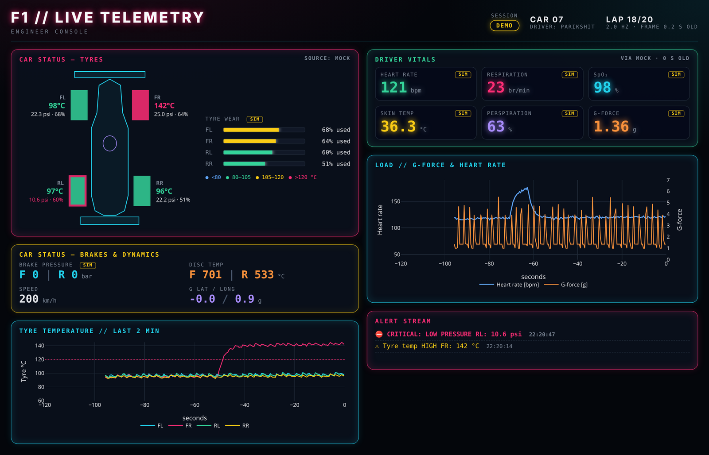
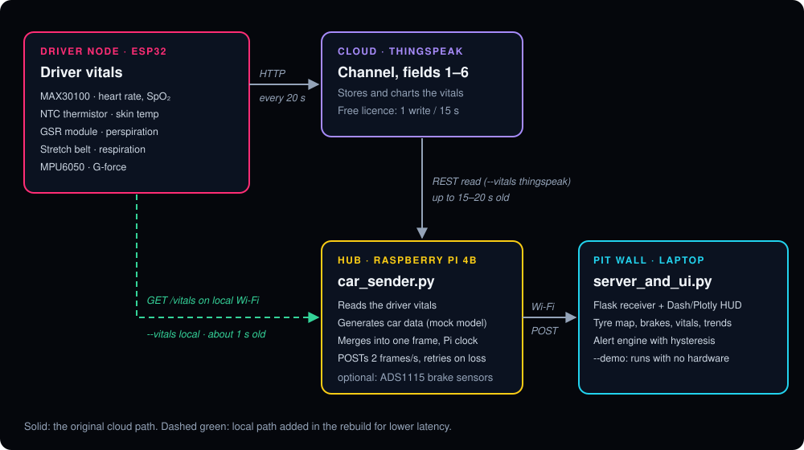
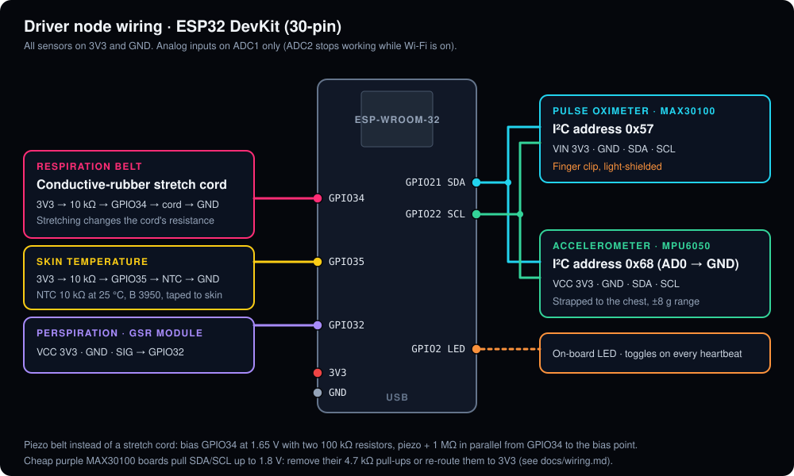
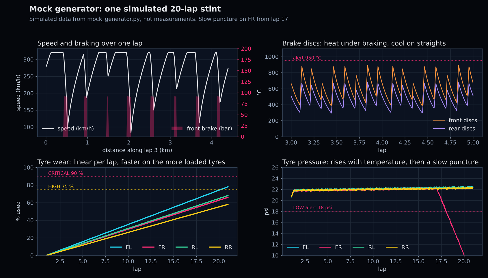

# F1 telemetry: ESP32 driver node → Raspberry Pi hub → pit-wall dashboard

A low-cost, Formula 1-style telemetry system. An ESP32 worn by the driver measures heart rate, SpO₂, skin temperature, perspiration, respiration and G-force. A Raspberry Pi merges the driver's vitals with car data (tyres, brakes, speed) into one telemetry frame and streams it over Wi-Fi to a pit-wall dashboard, which raises alerts when a value crosses a limit.

Started as my 5th-semester mini-project (B.E. ECE, BMS College of Engineering, Bengaluru, 2025). It led to my final-year project, a RISC-V vehicle control unit with CAN and LoRa telemetry on a real 1:10 car: [riscv-motorsport-vcu](https://github.com/kfcnode/riscv-motorsport-vcu).

> **About this repository.** The original 2025 source code was lost. This is a rewrite from the project report, done in November 2026, with the same architecture and file names. It also adds things the original didn't have: respiration and G-force uploads, a low-latency local path, plausibility filtering, alert hysteresis and tests. The Python side runs and is tested. The firmware's signal processing is unit-tested on a PC, but the sketch has not yet been flashed onto the original sensor hardware. The screenshots below come from the dashboard's demo mode (simulated data).



<sub>Demo mode, simulated data. Every value carries a SENSOR or SIM tag on the dashboard itself.</sub>

## Architecture



| Part | Runs on | File | Does |
|---|---|---|---|
| Driver node | ESP32 | `firmware/driver_node/` | Reads 5 sensors, uploads to ThingSpeak every 20 s, serves `GET /vitals` on the local Wi-Fi |
| Hub | Raspberry Pi 4B | `car_sender.py` | Reads the vitals (ThingSpeak, local, or simulated), adds car data, sends 2 frames/s |
| Car model | Pi or laptop | `mock_generator.py` | Simulated car on a 4.4 km circuit: speed, G, brakes, tyre temperature, pressure, wear, faults |
| Shared | all Python | `telemetry_common.py` | Frame layout, sanity limits, alert rules with hysteresis |
| Pit wall | laptop | `server_and_ui.py` | Flask receiver + Dash/Plotly dashboard |

## Real vs simulated

| Signal | Source | Sensor |
|---|---|---|
| Heart rate, SpO₂ | **Real** (driver node) | MAX30100 pulse oximeter |
| Skin temperature | **Real** (driver node) | 10 kΩ NTC thermistor |
| Perspiration | **Real** (driver node) | GSR module (relative index, 0–100 %) |
| Respiration rate | **Real** (driver node) | stretch-cord or piezo chest belt |
| G-force | **Real** (driver node) | MPU6050 accelerometer |
| Tyre pressure, temperature, wear | Simulated | `mock_generator.py` |
| Brake pressure | Simulated, or **real** with `--car ads1115` | 0.5–4.5 V transducers on an ADS1115 |
| Brake disc temperature, speed, car G | Simulated | `mock_generator.py` |

With `--vitals mock` (or `server_and_ui.py --demo`) the driver's vitals are simulated too. The dashboard shows the source of every value.

The car side is simulated on purpose: tyre wear over a stint, brake heat and a puncture can't be produced safely on a bench. The mock generator can also inject faults to test the alerts.

## Driver node



- `loop()` never blocks, because the MAX30100 library has to be called continuously to detect beats. The ThingSpeak upload runs in its own FreeRTOS task on the other core.
- Impossible readings (heart rate outside 30–220, SpO₂ above 100 %) are dropped, not uploaded.
- ThingSpeak's free licence accepts one write per channel every 15 s, so cloud data is up to about 35 s old by the time it reaches the dashboard. The local `GET /vitals` path is about 1 s old.

Parts list, pin table and setup: [`docs/wiring.md`](docs/wiring.md). Signal processing and timing: [`docs/design_notes.md`](docs/design_notes.md).

## Quick start: no hardware

```bash
pip install -r requirements.txt
python server_and_ui.py --demo --demo-lap 14 --speedup 3
```

Open http://127.0.0.1:8050. The demo starts at lap 14 of a 20-lap stint and injects a heart-rate spike, an overheating tyre and a puncture over the first 90 seconds.

## Running the full system

1. **Laptop:** `python server_and_ui.py`
2. **ESP32:** copy `firmware/driver_node/secrets.h.example` to `secrets.h` and fill it in. Install **MAX30100lib** from the Library Manager. Flash `driver_node.ino` with board *ESP32 Dev Module*. The serial monitor (115200) prints every reading once a second.
3. **Raspberry Pi:** copy `.env.example` to `.env`, fill it in, then run one of:

```bash
python car_sender.py --vitals local                      # driver node on the same Wi-Fi, ~1 s latency
python car_sender.py --vitals thingspeak                 # through the cloud, as in the original
python car_sender.py --vitals mock --fault puncture:RL@60  # no driver node; puncture after 60 s
```

`car_sender.py` keeps running through Wi-Fi drop-outs: failed sends are counted and logged every 10 s with the median and 95th-percentile send latency.

## Simulated stint



```bash
python mock_generator.py --laps 20 --puncture-lap 17 --csv stint.csv
python tools/plot_stint.py stint.csv images/mock_stint.png
```

## Tests

```bash
pip install -r requirements.txt pytest
python -m pytest -q
```

The tests cover the sanity limits, alert hysteresis, the mock model, ThingSpeak parsing, the hub-to-dashboard path end to end, and the firmware's signal processing (built with `g++`: NTC conversion, breath detection at 8–32 breaths/min, GSR index, G peak hold, JSON and ThingSpeak output). GitHub Actions also compiles the sketch for the ESP32.

## Repository layout

```
├── firmware/driver_node/
│   ├── driver_node.ino        sensors, ThingSpeak task, /vitals server
│   ├── vitals_dsp.h           signal processing (no Arduino code, unit-tested on a PC)
│   ├── config.h               pins, rates, calibration
│   └── secrets.h.example      Wi-Fi and ThingSpeak key → copy to secrets.h
├── car_sender.py              Raspberry Pi hub
├── server_and_ui.py           pit-wall dashboard (+ --demo)
├── telemetry_common.py        frame layout, limits, alerts
├── mock_generator.py          car + driver simulation, fault injection
├── assets/hud.css             dashboard styling
├── tools/                     fake driver node, screenshot and plot scripts
├── tests/                     pytest + firmware DSP tests
├── docs/                      wiring, design notes
└── images/                    README pictures
```

## Limitations

- Car data is simulated (apart from optional brake pressure).
- Wi-Fi and plain HTTP: short range, no deterministic timing, no encryption.
- Consumer PPG and GSR sensors are sensitive to movement and light; expect gaps on a moving driver.

The final-year project deals with the first two: CAN on the car, LoRa to the ground station, and a dedicated VCU reading real sensors.

## License

[MIT](LICENSE)
