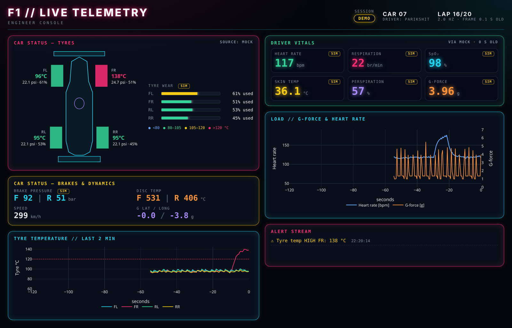
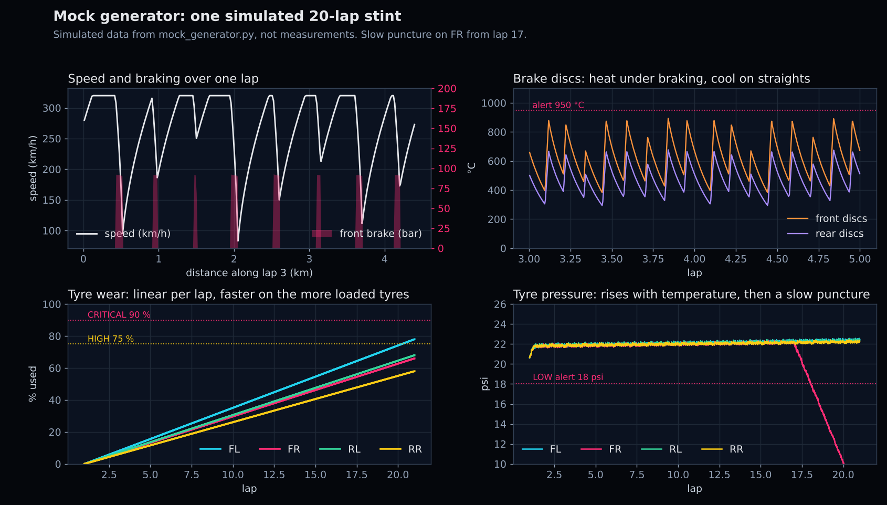

# Design notes

## Data flow and timing

| Stage | Rate | Age of driver data when it reaches the dashboard |
|---|---|---|
| ESP32 samples analog channels and IMU | 25 Hz | |
| MAX30100 (`pox.update()`) | as fast as `loop()` runs | |
| ESP32 → ThingSpeak | every 20 s | |
| Pi reads ThingSpeak (`--vitals thingspeak`) | every 5 s | **0–35 s** (20 s upload period + polling + cloud delay) |
| Pi reads the node directly (`--vitals local`) | every frame (2 Hz) | **about 1 s** |
| Pi → laptop | 2 frames/s | |
| Dashboard refresh | every 0.5 s | |

The 2025 version only had the cloud path, so the driver vitals were up to half a minute old. That is fine for trends and alerts on a slow-changing signal like skin temperature, but not for heart rate under load. The rebuild keeps the cloud path (logging, remote viewing) and adds the local path: the ESP32 serves `GET /vitals` on the same Wi-Fi, and the Pi reads it every frame. Each frame carries `driver.age_s`, and the dashboard shows it next to the vitals; an alert fires if it passes 45 s.

## Firmware structure

- `loop()` (core 1) never blocks: it calls `pox.update()` on every pass (the MAX30100 library needs a fast loop to see beats), samples at 25 Hz, serves `/vitals` and publishes a snapshot 4 times a second.
- The ThingSpeak upload runs in its own FreeRTOS task on core 0. An HTTP request can take a second; doing it in `loop()` would make the pulse oximeter miss beats.
- The two sides share one snapshot behind a mutex. The upload task asks `loop()` for the peak G since the last upload with a flag, so the peak is taken and reset in one place.
- Signal processing lives in `vitals_dsp.h`, with no Arduino code, so it is unit-tested on a PC (`tests/fw/test_dsp.cpp`).

## Signal processing

| Signal | Method |
|---|---|
| Heart rate, SpO₂ | MAX30100lib's beat detector. Reported only if a beat was seen in the last 5 s and the value is plausible. |
| Respiration | low-pass filter, slow baseline removed, amplitude tracked; a breath is a rising crossing of 0.4 × amplitude (Schmitt trigger), at most 50/min. Rate = mean of the last 5 intervals. No rate when the amplitude is too small or no breath for 12 s. |
| Skin temperature | NTC divider, Beta equation, slow EMA. Open or shorted sensor = no value. |
| Perspiration | GSR voltage relative to the driest reading in the first 10 s. 0–100 % index, not a physical unit. |
| G-force | magnitude of the acceleration vector (1 g at rest). /vitals: peak over the last second. ThingSpeak: peak since the last upload, so a short spike isn't missed between uploads. |

## Frame and sanity checks

Frame layout: see the docstring at the top of `telemetry_common.py`. Every driver value can be `null`. Values outside physical limits are dropped on the Pi as well as on the ESP32, so a glitch never reaches the dashboard as a number (the 2025 ThingSpeak log had SpO₂ readings above 100 % and heart rate jumping between 0 and 230). `sources.fields` marks each value as `sensor` or `sim`, and the dashboard prints that tag next to it.

## Alerts

All thresholds are in `telemetry_common.RULES`. Each alert is raised at one value and cleared at another (hysteresis), so a value sitting on a threshold doesn't make the alert flicker. A missing value keeps the alert as it was.

| Alert | Raised | Cleared |
|---|---|---|
| Tyre pressure low (CRIT) | < 18 psi | > 19 psi |
| Tyre temperature high | > 120 °C | < 112 °C |
| Tyre wear high / critical | > 75 % / > 90 % | < 74 % / < 89 % |
| Brake disc hot | > 950 °C | < 880 °C |
| Brake pressure excessive | > 110 bar | < 100 bar |
| Heart rate high (CRIT) | > 140 bpm | < 130 bpm |
| Heart rate low | < 45 bpm | > 50 bpm |
| SpO₂ low (CRIT) | < 92 % | > 94 % |
| Respiration high | > 30 /min | < 27 /min |
| Skin temperature high | > 38 °C | < 37.5 °C |
| G-force high | > 6.5 g | < 6.0 g |
| Driver data stale | older than 45 s | fresh again |

## Mock generator

A car on a virtual 4.4 km circuit with eight corners, about 64 s a lap:

- **Speed**: limited by braking (≈ 3.9 g) and acceleration envelopes around each corner's apex speed.
- **g_lat / g_long**: from the corner's peak lateral g (cos² shape through the corner) and dv/dt.
- **Brakes**: line pressure ∝ deceleration; disc temperature heats with brake power and cools with airflow.
- **Tyres**: temperature follows lateral/longitudinal load with an 8 s lag (outside tyres work harder); pressure follows temperature (ideal gas, set at 17.6 psi cold); wear is linear per lap, faster on the more loaded tyres and when hot.
- **Driver**: heart rate and respiration follow the 8 s average G load plus stint fatigue.
- **Faults**: puncture, tyre overheat, brake fade, heart-rate spike, driver-sensor dropout (`MockCar.inject`, or `car_sender.py --fault kind[:wheel]@seconds`).

These are deliberately simple models for exercising the pipeline and the alerts. They are not vehicle dynamics.

## Known limits

- The car side is simulated apart from the optional ADS1115 brake-pressure input.
- Wi-Fi and plain HTTP: short range, no deterministic timing, no encryption. ThingSpeak writes go over HTTP too.
- Consumer PPG and GSR sensors are motion-sensitive; on a moving driver expect gaps.
- One car, one driver node; no logging on the Pi beyond its console output.
