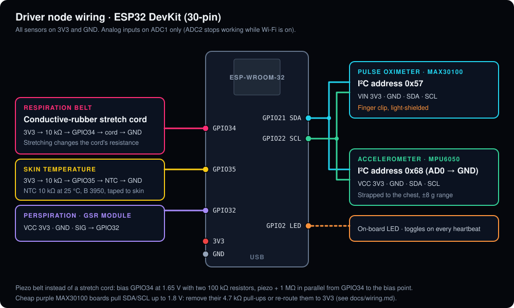

# Hardware and wiring



## Parts

| Part | Used for | Notes |
|---|---|---|
| ESP32 DevKit (ESP-WROOM-32, 30-pin) | driver node | any classic ESP32 board works; pins below |
| MAX30100 pulse-oximeter module | heart rate, SpO₂ | finger or earlobe clip, shielded from ambient light |
| MPU6050 (GY-521) | G-force | strapped flat to the chest |
| 10 kΩ NTC thermistor (B 3950) + 10 kΩ resistor | skin temperature | taped to the skin under the strap |
| GSR module (e.g. Grove GSR) | perspiration index | two finger electrodes |
| Conductive-rubber stretch cord + 10 kΩ resistor | respiration | in an elastic chest strap; a piezo film also works (see below) |
| Raspberry Pi 4B | hub | Raspberry Pi OS, Python 3.10+ |
| Laptop | pit wall | Windows, macOS or Linux, Python 3.10+ |
| *(optional)* ADS1115 + 2 × 0.5–4.5 V pressure transducers | real brake pressure on the Pi | `--car ads1115` |

## Driver node (ESP32)

| Sensor pin | ESP32 pin | |
|---|---|---|
| MAX30100 VIN / GND | 3V3 / GND | |
| MAX30100 SDA / SCL | GPIO21 / GPIO22 | shared I²C bus, 400 kHz |
| MPU6050 VCC / GND | 3V3 / GND | AD0 to GND (address 0x68) |
| MPU6050 SDA / SCL | GPIO21 / GPIO22 | |
| Stretch cord divider midpoint | GPIO34 | 3V3 → 10 kΩ → GPIO34 → cord → GND |
| NTC divider midpoint | GPIO35 | 3V3 → 10 kΩ → GPIO35 → NTC → GND |
| GSR module SIG | GPIO32 | module on 3V3 |
| on-board LED | GPIO2 | toggles on each detected heartbeat |

Things that will bite you:

- **Use ADC1 pins only (GPIO32–39).** ADC2 can't be read while Wi-Fi is running.
- **MAX30100 module pull-ups.** Most cheap purple MAX30100 boards pull SDA and SCL up to their own 1.8 V regulator through 4.7 kΩ resistors. With an ESP32 that often works badly or not at all, and the MPU6050 on the same bus sees 1.8 V logic. Either remove the three 4.7 kΩ pull-ups on the module and rely on the MPU6050 board's pull-ups to 3V3, or cut the trace and tie them to 3V3. Check that the serial log prints `MAX30100 ok`.
- **Light and movement** ruin PPG readings: shield the sensor and keep the hand still. The firmware drops impossible values (heart rate outside 30–220, SpO₂ outside 70–100) instead of sending them.
- **GSR calibration.** The perspiration index is relative: the first 10 s after power-up set the dry baseline. Keep hands dry and still for those 10 s; press EN (reset) to recalibrate.
- **Piezo belt instead of a stretch cord:** a piezo film gives an AC signal. Bias GPIO34 at 1.65 V with two 100 kΩ resistors (3V3 and GND), and connect the piezo with a 1 MΩ resistor in parallel between GPIO34 and that bias point. The detector removes the baseline either way.

## ThingSpeak channel

Create one channel with six fields, in this order:

| Field | Name | Unit |
|---|---|---|
| 1 | heart rate | bpm |
| 2 | SpO2 | % |
| 3 | skin temp | °C |
| 4 | perspiration | % (index) |
| 5 | respiration | breaths/min |
| 6 | peak G | g (highest since the previous upload) |

Put the **write** key in `firmware/driver_node/secrets.h`, and the channel ID and **read** key in `.env` on the Pi. The free licence accepts one write per channel every 15 s; the node writes every 20 s.

## Raspberry Pi

```bash
sudo apt install python3-venv
python3 -m venv .venv && . .venv/bin/activate
pip install -r requirements.txt
cp .env.example .env        # fill in
python car_sender.py --vitals thingspeak       # or --vitals local
```

For `--car ads1115`: enable I²C (`sudo raspi-config` → Interface Options → I2C), `pip install adafruit-circuitpython-ads1x15`, connect the ADS1115 to SDA1/SCL1 (pins 3 and 5), front transducer to A0, rear to A1. 5 V sensor outputs need a divider into the ADC (the code assumes ×1.5 to scale 4.5 V down to 3 V).
